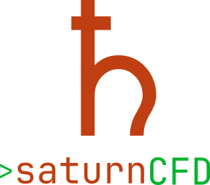
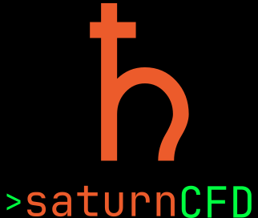

# saturnCFD logo

The primary mark is a compact Saturn emblem above the terminal-style lockup:

```text
   [Saturn]
> saturnCFD
```

The planet is deep orange, the ring and `>` prompt are green, and the wordmark
uses the project's monospace face. The SVG and PDF have transparent
backgrounds.

## Design

- Saturn emblem: deep-orange planet (`#bf3f12`) with an orange-red rim
  (`#ec5b2b`) and green ring segments (`#00b32d` / `#00ff40`).
- Wordmark: `saturnCFD`, with a green `>` prompt and `CFD`.
- The light/default version uses dark text on a transparent background; the
  dark version uses white `saturn` and bright green `CFD` on a black
  background.
- No trailing cursor: `>` is the prompt.
- The wordmark is outlined to paths, so no font installation is required.

## Files

```text
saturnCFD.svg             primary light/default vector (transparent)
saturnCFD.pdf             primary light/default vector PDF
saturnCFD-light.pdf       explicit light vector PDF
saturnCFD-Light.png       light preview
saturnCFD-Dark.png        dark-background preview
```

## Usage

```html
<!-- light page -->

```

In LaTeX, use the vector PDF:

```latex
\includegraphics[width=8cm]{saturnCFD.pdf}
```

For a dark slide or terminal page, use `saturnCFD-Dark.png`; keep clear space
around the lockup of at least one planet radius. Do not recolour, stretch or
crop the mark.

## Preview

| light | dark |
|---|---|
|  |  |
