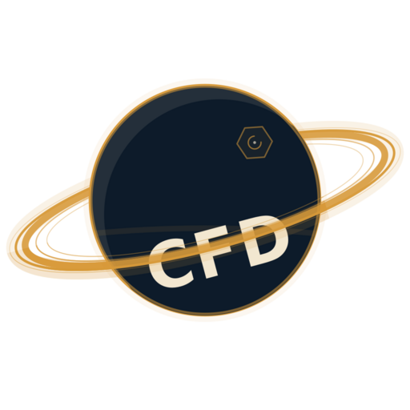
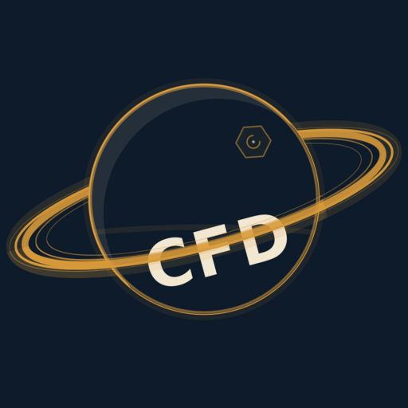

# saturnCFD logo

`saturnCFD.svg` is the project mark. `saturnCFD.png` (1024 px) and
`saturnCFD.pdf` (vector) are exports for places that cannot use SVG.

## Design

- A navy Saturn disc with a fine amber rim and fine concentric amber rings.
- The mark has **no background panel**, so the same files work on light and
  dark pages: on light backgrounds the navy sphere defines the shape; on dark
  backgrounds the amber rim, rings and cream wordmark carry it.
- The wordmark **CFD** sits in the lower gap between the planet and the front
  ring. The front ring crosses the top of the letters, so the word peeks out
  from under the ring without becoming unreadable.
- A small hexagonal polar vortex sits near the pole, drawn as a subtle amber
  line so it adds identity without competing with the wordmark.

Light and dark previews:

<table>
<tr>
<td></td>
<td></td>
</tr>
</table>

The mark uses exactly three base colours, with opacity variants only:

| role | colour |
|---|---|
| planet, dark contrast | navy `#0D1B2A` |
| wordmark, atmosphere | cream `#F2E7D0` |
| rings, rim, vortex | amber `#D89A3A` |

There are no stars, suns or other decorative objects.

## Usage

```html

```

In LaTeX:

```latex
\includegraphics[width=3cm]{saturnCFD.pdf}
```

Keep clear space around the mark of at least the width of the outer ring. Do
not recolour, outline, stretch or crop the mark.

## Files

```text
saturnCFD.svg             editable vector source (transparent background)
saturnCFD.png             1024 px transparent preview
saturnCFD.pdf             vector export for slides and print
saturnCFD-on-light.png    512 px preview on white
saturnCFD-on-dark.png     512 px preview on the logo navy
```
