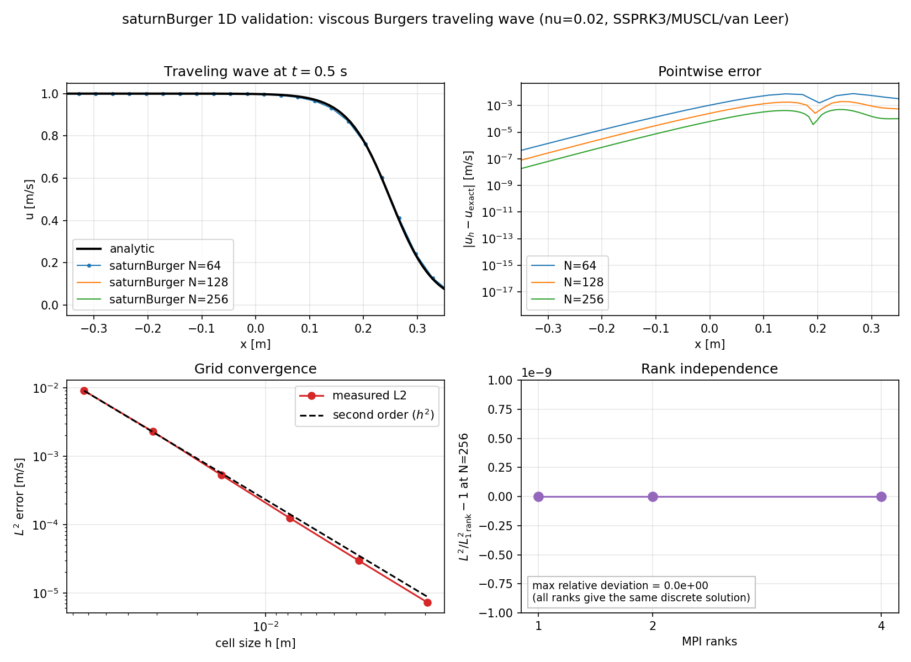
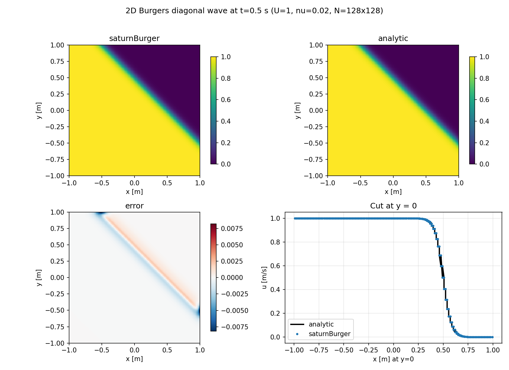
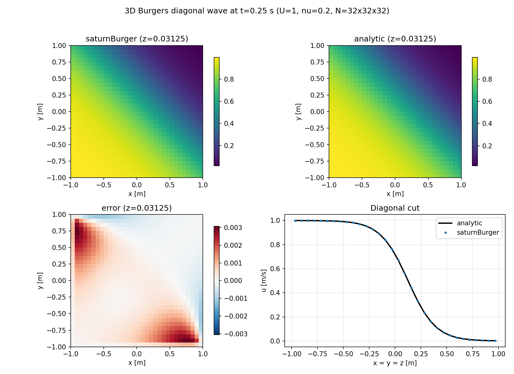

# Burgers validation — 1D scalar `saturnBurger`

**Solver:** `saturnBurger` (class `saturn::SaturnBurger`)

**Equation:** $\partial_t u + \partial_x(u^2/2) = \nu\partial_{xx}u$

**Case:** `tests/regression/burgers/traveling64.yaml`

**Reproduction:** `python3 tools/validateBurgers.py`

This page records the analytic validation of the 1D solver. The reference is
the exact viscous traveling wave

$$
u(x,t)=\frac{U}{2}\left[
1-\tanh\left(\frac{U(x-x_0-Ut/2)}{4\nu}\right)\right],
\qquad U=1,\ \nu=0.02,\ x_0=0,
$$

on $x\in[-1,1]$ up to $t=0.5$ s. Dirichlet boundary data follow the wave;
the initial state is the same wave at $t=0$.



## Measured convergence

CPU OpenMP build, MUSCL/van Leer, SSPRK3, CFL 0.3:

| N | $h$ | $L^1$ | $L^2$ | $L^\infty$ | observed order |
|---:|---:|---:|---:|---:|---:|
| 32 | 0.0625 | 3.911e-3 | 9.015e-3 | 2.981e-2 | — |
| 64 | 0.03125 | 9.965e-4 | 2.284e-3 | 7.977e-3 | 1.98 |
| 128 | 0.015625 | 2.259e-4 | 5.291e-4 | 2.009e-3 | 2.11 |
| 256 | 0.0078125 | 5.174e-5 | 1.236e-4 | 5.063e-4 | 2.10 |
| 512 | 0.00390625 | 1.226e-5 | 2.973e-5 | 1.271e-4 | 2.06 |
| 1024 | 0.001953125 | 2.977e-6 | 7.287e-6 | 3.173e-5 | 2.03 |

The observed order is close to two at every refinement. The error at the
finest grid is $7.3\times10^{-6}$ in $L^2$ and $3.2\times10^{-5}$ in
$L^\infty$, out of a unit-amplitude wave. This is the expected truncation error
of a second-order scheme, not a rank or boundary artefact.

## Rank independence

At $N=256$, 1, 2 and 4 ranks produce the same discrete solution:

| ranks | $L^1$ | $L^2$ | $L^\infty$ |
|---:|---:|---:|---:|
| 1 | 5.173840745110388e-05 | 1.2363783241939333e-04 | 5.062617877850117e-04 |
| 2 | 5.173840745110388e-05 | 1.2363783241939333e-04 | 5.062617877850117e-04 |
| 4 | 5.173840745110388e-05 | 1.2363783241939333e-04 | 5.062617877850117e-04 |

The relative $L^2$ difference is exactly zero. The earlier $\sqrt{n_{\rm ranks}}$
growth was caused by the validation diagnostic dividing by the local owned-cell
count instead of the global count; the solver RHS, halo exchange and reduction
were already rank independent.

## Other checks

| check | result |
|---|---|
| constant field, periodic, inviscid | preserved exactly |
| periodic inviscid shock, $u_0=-\sin(\pi x)$, $N=128$, $t=0.5$ | bounds $[-0.9954,0.9954]$, integral $1.5\times10^{-16}$ |
| constant Burgers flux | zero divergence; face flux $-0.5/+0.5$ |
| YAML CLI path | `saturnCFD case.yaml` writes CSV and JSON; CTest checks the norms |

## Standalone example

A user-facing case lives in `examples/saturnBurger/saturnBurger1D/`:

```bash
cd examples/saturnBurger/saturnBurger1D
saturnCFD saturnBurger.yaml
python3 compareAnalytic.py
```

It uses 256 cells on $[0,1]$, $x_0=0.25$, $U=1$, $\nu=0.02$. The checked-in
case uses $t=1.5$ s, where the centre reaches the outlet; $t=0.5$ s is the
cleaner interior validation point. `compareAnalytic.py` re-reads the case
parameters, recomputes the $\tanh$ solution independently and checks:

```text
L1 error    : 3.089618e-05
L2 error    : 8.050775e-05
Linf error  : 5.741723e-04
PASS: L2 8.050775e-05 <= tolerance 1.0e-04
```

It also writes `results/saturnBurger/comparison.png`. The raw final-time field
is `results/saturnBurger/traveling.csv` (`x,u_numerical,u_exact,error`); the
JSON summary includes `wallSeconds`. Set `output.vtkEvery: N` to write
`traveling_<step>.vtu` frames and `traveling.pvd` for ParaView. CTest
validates the example schema; the numerical regression is the stable
`tests/regression/burgers/traveling64.yaml`, and `burgers_vtk` checks the VTK
sequence.

## 2D diagonal wave

The 2D conservative form is

$$
u_t + (u^2/2)_x + (u^2/2)_y
= \nu(u_{xx}+u_{yy}),
$$

with an exact diagonal plane wave

$$
u(x,y,t)=\frac{U}{2}\left[
1-\tanh\left(\frac{U(x+y-x_0-y_0-Ut)}{4\nu}\right)\right].
$$

Measured on $[-1,1]^2$, $U=1$, $\nu=0.02$, $t=0.5$:

| grid | $L^2$ | observed order |
|---:|---:|---:|
| 32x32 | 9.909e-3 | — |
| 64x64 | 2.555e-3 | 1.96 |
| 128x128 | 5.968e-4 | 2.10 |

The separate user example is `examples/saturnBurger/saturnBurger2D/`; the 1D example is
unchanged. `python3 examples/saturnBurger/saturnBurger2D/compareAnalytic.py` recomputes the
2D tanh solution and writes a four-panel comparison plot.



## 3D diagonal wave

The 3D conservative form is

$$
u_t + (u^2/2)_x + (u^2/2)_y + (u^2/2)_z
= \nu(u_{xx}+u_{yy}+u_{zz}),
$$

with the exact diagonal plane wave

$$
u(x,y,z,t)=\frac{U}{2}\left[
1-\tanh\left(
\frac{U(x+y+z-x_0-y_0-z_0-\frac32Ut)}{4\nu}
\right)\right].
$$

The 3D example uses $32^3$ cells, $\nu=0.2$, $t=0.25$ and reports
$L^2=8.967\times10^{-4}$; the plane-wave unit test gives
$L^2=3.363\times10^{-3}\to1.303\times10^{-3}$ at $8^3\to16^3$ (observed
order 1.37 on these coarse grids). A dense cluster run is the next step for
the asymptotic 3D order.



## Checkpoint and restart

`output.checkpointEvery: N` writes `<prefix>_<step>.chk` at step 0, every N
steps and the final state. A restart case sets:

```yaml
restart:
  file: results/burgers/checkpoint_000005.chk
```

The restart resumes at the checkpoint step and time and continues to
`time.end`. `burgers_checkpoint` verifies that the restarted final norms match
an uninterrupted reference run.

## Reproduce


```bash
cmake --preset default
cmake --build buildCPU -j

# one case through the registered CLI
./buildCPU/saturnCFD -checkConfig \
  tests/regression/burgers/traveling64.yaml
./buildCPU/saturnCFD tests/regression/burgers/traveling64.yaml

# the full table, rank sweep and figure
python3 tools/validateBurgers.py

# 2D example + independent comparison
cd examples/saturnBurger/saturnBurger2D
saturnCFD saturnBurger2D.yaml
python3 compareAnalytic.py

# CTest slices
ctest --preset burgers
ctest --preset burgers2d
```

Outputs:

```text
results/burgers/validation/convergence.csv
results/burgers/validation/rankIndependence.csv
docs/validation/figures/burgersValidation.{png,pdf}
```

## Verdict

The 1D and 2D scalar `saturnBurger` solver is validated:

- 1D matches the analytic traveling wave with second-order convergence; the
  error is rank independent and identical on 1/2/4 ranks;
- 2D matches the analytic diagonal plane wave with observed orders 1.96/2.10;
- the 1D periodic inviscid shock is conservative and bounded;
- both are registered and run through proper YAML cases.

The next extension is 3D, which needs the third flux component.
