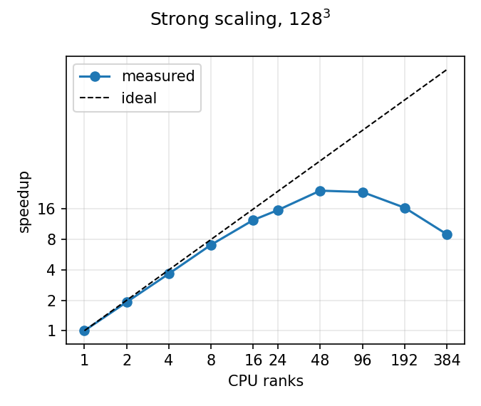
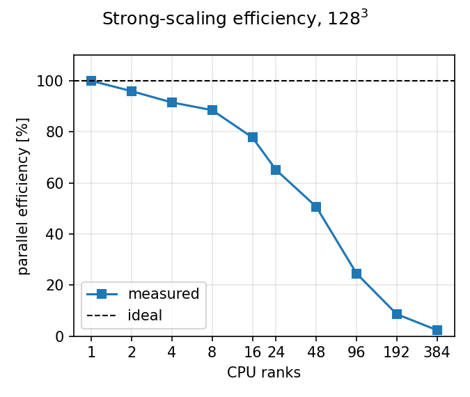
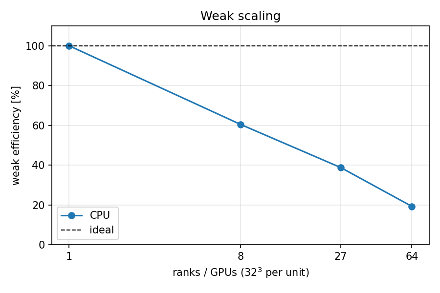

# Scaling of `saturnHeat` on PARAM Shakthi

This page records the first CPU scaling campaign, including the parts that did
**not** scale well. It is a lab notebook: the numbers are what came out of the
cluster, and the interpretation is separate from the claim.

The GPU points were never delivered by the queue, so this page is CPU only.
`docs/master.md` section 8 explains the vocabulary (rank, thread, unit).

## Case

| item | strong | weak |
|---|---|---|
| solver | `saturnHeat`, 3D box, periodic | same |
| mesh | 128³ (2,097,152 cells); 256³ for the dense points | 32³ per rank |
| end time / step | `end 0.1`, adaptive, `dtMax 1e-3` (197 steps on 128³, 787 on 256³) | `end 0.05`, fixed `dt 5e-4` (100 steps) |
| numerics | MUSCL + van Leer, SSPRK3, α = 0.01 | same |
| output | analytic L2 at the final time | same |

Hardware: 2× Xeon Gold 6240R per node (48 cores, 192 GB), OpenMPI 5.0.6,
one OpenMP thread per MPI rank, `--bind-to core --map-by core`. The 48-thread
row is one process on one node instead.

## Strong scaling, 128³

| ranks | s/step | speedup | efficiency | cells/rank |
|---|---|---|---|---|
| 1 | 6.1888 | 1.00 | 100% | 2,097,152 |
| 2 | 3.2255 | 1.92 | 96% | 1,048,576 |
| 4 | 1.6903 | 3.66 | 92% | 524,288 |
| 8 | 0.8740 | 7.08 | 89% | 262,144 |
| 16 | 0.4971 | 12.45 | 78% | 131,072 |
| 24 | 0.3959 | 15.63 | 65% | 87,381 |
| 48 | 0.2545 | 24.32 | 51% | 43,690 |
| 96 | 0.2627 | 23.56 | 25% | 21,845 |
| 192 | 0.3754 | 16.49 | 9% | 10,922 |
| 384 | 0.6880 | 9.00 | 2% | 5,461 |
| 1 rank × 48 threads | 0.2076 | 29.81 | — | 2,097,152 |





Dense points, 256³ (787 steps, so compare s/step, not wall):

| ranks | nodes | s/step | cells/rank |
|---|---|---|---|
| 48 | 1 | 1.5279 | 349,525 |
| 192 | 4 | 1.0143 | 87,381 |
| 384 | 8 | 1.4732 | 43,690 |

## Weak scaling, 32³ per rank

| ranks | case | s/step | efficiency |
|---|---|---|---|
| 1 | `heatWeak032` | 0.0678 | 100% |
| 8 | `heatWeak064` | 0.1121 | 60% |
| 27 | `heatWeak096` | 0.1748 | 39% |
| 64 | `heatWeak128` | 0.3517 | 19% |



## What the numbers say

1. **Inside one node the curve is sane.** 48 ranks reach 24.3× on 48 cores
   (51%), and the single 48-thread process is 1.23× faster still
   (0.208 vs 0.254 s/step). The gap between the two is parallel overhead, not
   memory bandwidth: same cores, same problem, one has MPI.
2. **Beyond one node it gets worse, not better.** 96 ranks is no faster than
   48, and 192 and 384 are slower than both. A compute-bound code would keep
   improving; this is the signature of a communication cost that grows with the
   number of ranks. The 256³ points show the same shape: 192 ranks (4 nodes) is
   the best dense point, 384 (8 nodes) is worse.
3. **Weak scaling is poor even on one node.** 60% at 8 ranks is not a network
   effect. 32³ per rank is simply too small: with the two-cell ghost layer a
   32³ block is effectively 36³ (+42% cells), and each step does three halo
   exchanges (one per SSPRK3 stage) of twelve messages.

## Cause

- **Work per rank.** At 384 ranks each rank owns 5,461 cells. The kernels need
  roughly 10⁴ cells per rank before the halo exchange amortises, so the last
  three points are outside the useful range for this mesh.
- **Broken MPI transport on the compute nodes.** Every job log carries

  ```text
  UCP API version is incompatible: required >= 1.17, actual 1.16.0
  (loaded from /lib64/libucp.so.0)
  ```

  so OpenMPI 5.0.6 cannot initialise UCX and falls back to a slower path. The
  collapse exactly at node boundaries (48 → 96 ranks) is consistent with
  inter-node latency far above the few microseconds the halo exchange expects.
  This is an environment problem, not a solver problem.
- **Three halo exchanges per step.** The SSPRK3 step calls
  `applyBoundaryConditions()` after every stage, and each call exchanges all
  twelve neighbour faces.

## What to claim, and what not to

- Claim the single-node result: **24× on 48 cores, 51% efficiency** for 128³,
  and the 48-thread process marginally faster than 48 ranks.
- Do **not** present the 384-rank point as the code's scaling limit; it is a
  lower bound measured through a broken transport.
- Do **not** quote a GPU speedup from this dataset: the GPU jobs never ran.

## What to run next

On a single-node machine (lab PC) the transport issue disappears, so the same
run gives the honest CPU curve up to the core count, plus one GPU point:

```bash
cd HPC/paramsakthi
./tests/runScaling                  # auto-detects cores and GPUs
./tests/runScaling --weak-n 64      # weak case with 64^3 per rank
```

`--weak-n 64` replaces the 32³-per-rank weak series with 64³ per rank
(64³, 128³, 192³, 256³ for 1, 8, 27, 64 units), which is the right size at
tens of cores.

If the cluster is used again for multi-node, fix UCX first (load the module
that provides UCX ≥ 1.17, or force `--mca pml ob1 --mca btl self,vader,openib`)
and re-run only the ≥96-rank points for comparison.

## Data

- `docs/validation/scaling/strong/strong.csv`, `weak/weak.csv`: the merged
  measurements (`backend, case, units, threads, steps, wall, spt, cells, l2`).
- Figures are regenerated from those JSONs by
  `./tests/runScaling --plot-only`.
- Raw JSON and Slurm logs stay next to the results on the cluster
  (`tests/scaling/{strong,weak}/*.json`, `tests/scaling/logs/*.out`).
