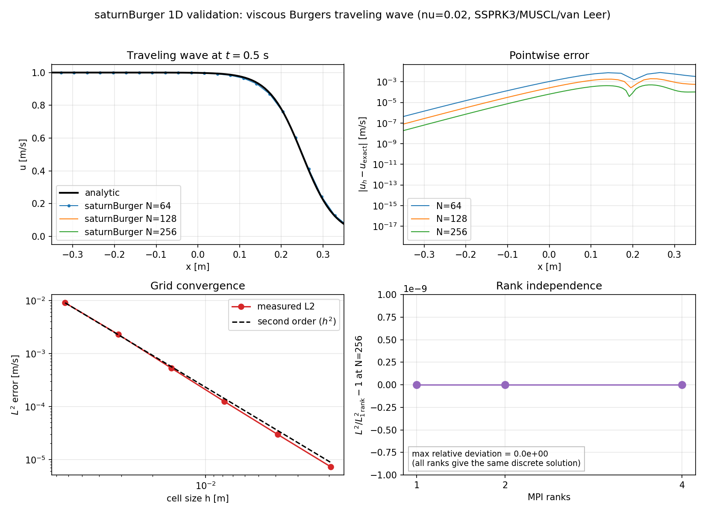

# saturnBurger — 1D/2D/3D scalar Burgers solver

**Target:** `saturnBurger`

**Class:** `saturn::SaturnBurger`

**Registered name:** `saturnBurger`

**Equation:** 1D/2D/3D scalar Burgers

$$
\frac{\partial u}{\partial t}
+ \frac{\partial}{\partial x}\left(\frac{u^2}{2}\right)
= \nu\frac{\partial^2 u}{\partial x^2} + s .
$$

This is the first production solver and is fully registered in the CLI:
`saturnCFD -listSolvers` prints `saturnBurger`, and a case file runs with
`saturnCFD case.yaml`. The solver supports structured 1D, 2D and 3D blocks;
the multi-dimensional form uses the conservative flux vector
F(u) = (u^2/2, u^2/2, u^2/2).

## Files

```text
src/solvers/saturnBurger/
  CMakeLists.txt       target saturnBurger
  SaturnBurger.hpp     options, solver class, profile/error diagnostics
  SaturnBurger.cpp     FVM assembly, boundary fill, RHS, profile gathering
  BurgersCase.hpp      YAML schema, case factory and registration
  BurgersCase.cpp      mesh, initial/boundary/exact data, registry entry
  README.md            this page
```

## Why the files are split

- `SaturnBurger.hpp/.cpp` is the **physics and numerics**: mesh partition,
  fields, Burgers flux, diffusion, boundary refresh, RHS and time state. It
  does not include `Config`, YAML or the registry.
- `BurgersCase.hpp/.cpp` is the **case layer**: the YAML schema, mesh choice,
  `burgers.initial` presets, the exact traveling-wave helper and the registry
  entry. It translates a case file into a `SaturnBurger`.
- `README.md` documents both.

This keeps the solver usable from C++ tests without YAML, and keeps YAML and
case presets out of the RHS. There are **no tests** in this directory: all
tests are in `tests/TestSaturnBurger.cpp`, `tests/regression/burgers/` and
`docs/validation/scripts/validateBurgers.py`. The `profile`/`exactError` methods are user-facing
CLI diagnostics (`output.exact` and `output.csv`), not test code.

`BurgersCase` is not redundant with `SaturnBurger`: one is "what case", the
other is "how to advance it". If they were merged, the physics class would
have to include `Config`, `ConfigSchema`, `MeshFactory` and the registry.

## Running the YAML case

```bash
cmake --preset default
cmake --build buildCPU -j
./buildCPU/saturnCFD -listSolvers                 # saturnBurger
./buildCPU/saturnCFD -dumpConfig saturnBurger     # full template
./buildCPU/saturnCFD -checkConfig \
  tests/regression/burgers/traveling64.yaml
./buildCPU/saturnCFD tests/regression/burgers/traveling64.yaml
mpirun -np 4 ./buildCPU/saturnCFD \
  tests/regression/burgers/traveling64.yaml
```

A standalone user example with an independent analytic check is in
`examples/saturnBurger/saturnBurger1D/`:

```bash
cd examples/saturnBurger/saturnBurger1D
saturnCFD saturnBurger.yaml
python3 compareAnalytic.py
```

It uses 256 cells on $[0,1]$, $x_0=0.25$ and $t=1.5$ s and reports
$L^2=8.051\times10^{-5}$ against the exact wave ($t=0.5$ s gives
$4.226\times10^{-5}$ and keeps the wave away from the outlet). The script
recomputes the analytic solution from the case parameters rather than trusting
the solver's `u_exact` column.

The case writes `results/burgers/traveling64.csv` and `.json` when
`output.csv` and `output.json` are true. The CSV is the raw field at the final
time, one row per cell:

```text
x,u_numerical,u_exact,error
```

The JSON stores `wallSeconds`, `l1/l2/linf` of the state and the analytic
error. The prefix is relative to the current working directory.

Set `output.vtkEvery: N` to write the `u` cell field every `N` accepted time
steps:

```text
results/burgers/traveling64_000000.vtu
results/burgers/traveling64_000010.vtu
...
results/burgers/traveling64.pvd
```

The first frame is step 0, then every `N` steps, plus the final state. Open the
`.pvd` collection in ParaView. `vtkEvery: 0` disables field output. VTK output
is currently supported by `saturnBurger` only.

Set `output.checkpointEvery: N` to write binary checkpoints
`<prefix>_<step>.chk` (step 0, every N steps, final state). Resume with:

```yaml
restart:
  file: results/burgers/traveling64_000010.chk
```

The checkpoint stores the solver, dimension, grid, step, time and the global
cell field. The restart run uses the checkpoint time and step and continues to
`time.end`. The mesh and solver name must match.

With MPI, the CLI chooses `OMP_NUM_THREADS = max(1, cores/ranks)` unless it is
already set, and passes it explicitly to Kokkos; this avoids oversubscription
when several ranks share a node.

### YAML keys

| key | meaning |
|---|---|
| `mesh.type` | `auto`, `gmsh` or `box` |
| `mesh.nx/ny/nz` | box cell counts; 1D needs `ny = nz = 1`, 2D needs `nz = 1` |
| `mesh.box.*` | box bounds in metres |
| `time.start/end/dtMax/cfl/maxSteps` | time control |
| `time.scheme` | `forwardEuler`, `ssprk2`, `ssprk3` |
| `burgers.nu` | kinematic viscosity |
| `burgers.velocity` | traveling-wave speed $U$ |
| `burgers.x0` | traveling-wave x centre at $t=0$ |
| `burgers.y0` | traveling-wave y centre at $t=0$ (2D/3D) |
| `burgers.z0` | traveling-wave z centre at $t=0$ (3D) |
| `burgers.source` | constant source |
| `burgers.periodic` | periodic x boundaries |
| `burgers.initial` | `travelingWave`, `sine` or `constant` |
| `numerics.convection` | `upwind`, `rusanov` or `muscl` |
| `numerics.limiter` | `minmod`, `vanLeer` or `superbee` |
| `output.prefix` | output path without extension |
| `output.csv/json/exact` | profile, summary and analytic comparison |
| `output.vtkEvery` | write the `u` cell field every N steps plus a PVD |
| `output.checkpointEvery` | write a restart checkpoint every N steps |
| `restart.file` | checkpoint to resume from |

## Mesh and layout

Requirements:

- a structured 1D (`ny = nz = 1`), 2D (`nz = 1`) or 3D block;
- `computeGeometry()` and `detectStructured()` already called;
- at least two cells per rank when `nGrow = 2`.

The case factory builds the mesh with `makeMeshFromConfig` (a structured box
or a checked Gmsh mesh), then the solver constructs:

```text
MeshPartition  (nx, 1, 1, periodic, false, false)
LocalMesh      nGrow = 2
CellField u    nGrow = 2
FaceField flux, lapFace
CellField div, lap, grad
```

The shared FVM layer supplies `LocalMesh`, `FieldHalo`, `fillBoundaryGhosts`,
`divergence`, and `laplacian`.

## Discretisation

### Convective flux

Burgers is a scalar conservation law with flux

$$
f(u) = \frac{u^2}{2}, \qquad f'(u)=u.
$$

`burgersFlux` in `src/fv/Convection.cpp` computes the **outward normal flux**.
In 1D that is f(u)n_x. In 2D/3D the flux vector is F(u)=(f(u),f(u),f(u)), so the face
flux is f(u)(n_x+n_y+n_z). The canonical face orientation is "lower-coordinate cell
on the left, higher-coordinate cell on the right", independent of which cell
owns the face. That makes the flux antisymmetric across a shared face, which is
required for conservation.

Schemes:

| scheme | face states | flux |
|---|---|---|
| `Rusanov` | cell values | local Lax–Friedrichs |
| `Muscl` | MUSCL-reconstructed left/right | local Lax–Friedrichs |
| `Upwind` | cell values | Godunov (shock/rarefaction) |

The default is `Muscl` with the van Leer limiter. The MUSCL reconstruction
needs two ghost layers; the solver enforces that.

### Diffusion

Diffusion uses the shared non-orthogonal corrected `laplacian` on `LocalMesh`:

$$
\frac{1}{V_P}\sum_f \nu A_f
\frac{(\phi_N-\phi_P)-\mathbf{d}\cdot\nabla_t\phi_f}{d_\perp}.
$$

For the 1D block this reduces to the three-point stencil; in 2D it is the
five-point stencil on an orthogonal mesh. `nu = 0` is allowed for the inviscid
equation.

### Source

`BurgersOptions::source` is a constant source per unit volume. A spatially
varying manufactured source is a later extension.

## Time integration

`SaturnBurger` implements `Solver::rhs`; `Simulation` owns the time loop.
Implemented schemes are forward Euler, SSPRK2 and SSPRK3. The recommended
choice is **SSPRK3** with a CFL around 0.3.

`TimeControl::stableDt` uses

$$
\Delta t_{\mathrm{conv}} = \mathrm{CFL}\frac{h_{\min}}{\max|u|},
\qquad
\Delta t_{\mathrm{diff}} = \frac{s h_{\min}^2}{2d\nu}.
$$

For $\nu>0$ the diffusive limit can dominate on fine meshes. The explicit
diffusion solve is the current implementation; implicit/IMEX diffusion through
`saturnLinAlg` is the next step.

The solver implements `setTime`, so time-dependent Dirichlet data at a moving
exact boundary is refreshed after every RK stage.

## Boundary conditions

- **Periodic:** `BurgersOptions::periodic = true`; only `FieldHalo`.
- **Dirichlet:** set `dirichlet(x, time, component)`; the callback is evaluated
  at the face centroid and the ghost is the mirror `2g - u_P`.
- **Neumann:** not exposed in the first solver; add it by extending
  `BurgersOptions` and `fillBoundaryGhosts`.

A 1D mesh may still carry `ymin`/`ymax`/`zmin`/`zmax` patches; the solver loops
only the active directions. In 2D all four side patches are used.

## Initial condition

`BurgersOptions::initial(x)` is required and is evaluated at cell centroids.
`applyInitialConditions` fills the host view and refreshes ghosts.

The YAML factory provides three initial states:

| `burgers.initial` | initial state | boundaries | exact reference | use |
|---|---|---|---|---|
| `travelingWave` | 1D: $\frac{U}{2}[1-\tanh(\frac{U(x-x_0)}{4\nu})]$; 2D: $\frac{U}{2}[1-\tanh(\frac{U(x+y-x_0-y_0)}{4\nu})]$; 3D adds $z-z_0$ and $\frac32Ut$ | time-dependent Dirichlet from the exact solution | yes | quantitative validation |
| `sine` | 1D $u_0=-\sin(\pi x)$; 2D product; 3D product of three sines | periodic only | no | shock, TVD/boundedness |
| `constant` | $u_0=v$ (`burgers.value`) | constant Dirichlet (or periodic) | no | flux/conservation sanity |

`travelingWave` is the default because it is the only preset with a known
analytic solution at every time. The other two test qualitative behavior, not
pointwise accuracy.

A **traveling wave** means the profile keeps its shape and moves at constant
speed: $u(x,t)=f(x-Ut)$. For viscous Burgers the tanh profile is an exact
solution because nonlinear steepening balances diffusion. It is not a
numerical scheme; it is a physical solution used for initial data, boundary
data and the error norm reference.

## Validation against the analytic solution

The exact viscous traveling waves are

$$
u(x,t)=\frac{U}{2}\left[
1-\tanh\left(\frac{U(x-x_0-Ut/2)}{4\nu}\right)\right]
$$

in 1D, and

$$
u(x,y,t)=\frac{U}{2}\left[
1-\tanh\left(\frac{U(x+y-x_0-y_0-Ut)}{4\nu}\right)\right]
$$

in 2D, and

$$
u(x,y,z,t)=\frac{U}{2}\left[
1-\tanh\left(\frac{U(x+y+z-x_0-y_0-z_0-\frac32Ut)}{4\nu}\right)\right]
$$

in 3D. The 2D front is the line $x+y=x_0+y_0+Ut$; the 3D front is the plane
$x+y+z=x_0+y_0+z_0+\frac32Ut$.

`docs/validation/scripts/validateBurgers.py` runs the real YAML case at several resolutions and
rank counts, writes `convergence.csv` and `rankIndependence.csv`, and produces

```text
docs/validation/figures/burgersValidation.png
docs/validation/figures/burgersValidation.pdf
```



Measured on the CPU OpenMP build, $t=0.5$ s, MUSCL/van Leer, SSPRK3, CFL 0.3:

| N | $h$ | $L^1$ | $L^2$ | $L^\infty$ | observed order |
|---:|---:|---:|---:|---:|---:|
| 32 | 0.0625 | 3.911e-3 | 9.015e-3 | 2.981e-2 | — |
| 64 | 0.03125 | 9.965e-4 | 2.284e-3 | 7.977e-3 | 1.98 |
| 128 | 0.015625 | 2.259e-4 | 5.291e-4 | 2.009e-3 | 2.11 |
| 256 | 0.0078125 | 5.174e-5 | 1.236e-4 | 5.063e-4 | 2.10 |
| 512 | 0.00390625 | 1.226e-5 | 2.973e-5 | 1.271e-4 | 2.06 |
| 1024 | 0.001953125 | 2.977e-6 | 7.287e-6 | 3.173e-5 | 2.03 |

The error falls from $9.0\times10^{-3}$ to $7.3\times10^{-6}$ under five
refinements, with a clean second-order slope. The remaining non-zero value is
the expected discretisation error of a second-order scheme; it tends to zero
as $h^2$.

### Rank independence

At $N=256$ the three rank counts give bitwise-identical norms:

| ranks | $L^1$ | $L^2$ | $L^\infty$ |
|---:|---:|---:|---:|
| 1 | 5.173840745110388e-05 | 1.2363783241939333e-04 | 5.062617877850117e-04 |
| 2 | 5.173840745110388e-05 | 1.2363783241939333e-04 | 5.062617877850117e-04 |
| 4 | 5.173840745110388e-05 | 1.2363783241939333e-04 | 5.062617877850117e-04 |

An earlier apparent $\sqrt{n_{\rm ranks}}$ growth came from the test
diagnostic dividing by the **local** owned-cell count. It now uses the global
count; the solver itself was already rank independent.

### Other tests

`tests/TestSaturnBurger.cpp`:

| case | result |
|---|---|
| 1D viscous traveling wave, $N=32/64/128/256$, $\nu=0.02$, $t=0.5$ | monotone convergence, orders 1.98/2.11/2.10 |
| 2D diagonal wave, $N=32/64$, $\nu=0.02$, $t=0.5$ | $L^2$ 9.909e-3 -> 2.555e-3, order 1.96 |
| 3D x-plane wave, $N=8/16$, $\nu=0.2$, $t=0.25$ | $L^2$ 3.363e-3 -> 1.303e-3, order 1.37 |
| 3D diagonal example, $N=32^3$, $\nu=0.2$, $t=0.25$ | $L^2=8.967e-4$ |
| constant field, periodic, inviscid | stays exactly 1 |
| periodic inviscid shock, $u_0=-\sin(\pi x)$, $t=0.5$ | bounds $[-0.9954, 0.9954]$, integral $1.5\times10^{-16}$ |
| Burgers constant flux | zero divergence, face flux $-0.5/+0.5$ |

The shock test checks the TVD/boundedness property and discrete conservation.
The YAML regression `tests/regression/burgers/traveling64.yaml` checks the
actual CLI path, including the CSV and JSON output.

## Why this solver first

- It has an exact viscous solution.
- It exercises nonlinear convection, limiters, time integration, diffusion,
  boundary ghosts, conservation and MPI.
- It is the bridge to Navier–Stokes: same convective and diffusive terms, no
  pressure or continuity.

## Limitations and next steps

- 1D, 2D and 3D; 2D requires `nz = 1`.
- Constant source only.
- Explicit diffusion; implicit/IMEX BE/CN/BDF2 waits for the FV Poisson matrix
  assembler and `saturnLinAlg`.
- The shock test is conservative and bounded but does not yet report a
  pointwise shock-speed order.
- Neumann boundaries and a spatially varying source are not exposed yet.
- A 3D extension would add the third flux component. The 2D example is in
  `examples/saturnBurger/saturnBurger2D/`; the 1D example is unchanged.

## Using the solver as a library

```cpp
BurgersOptions options;
options.nu = 0.02;
options.periodic = false;
options.convection = ConvectiveScheme::Muscl;
options.limiter = Limiter::VanLeer;
options.initial = [](const Vec3& x) { return exact(x.x, 0); };
options.dirichlet = [](const Vec3& x, Real t, int) {
  return exact(x.x, t);
};
options.exact = [](const Vec3& x, Real t) { return exact(x.x, t); };

SaturnBurger solver(std::move(mesh), options);
TimeControl control;
control.tEnd = 0.5;
control.cfl = 0.3;

Simulation simulation(solver, control, TimeScheme::SSPRK3);
const SimulationResult result = simulation.run();

if (solver.hasExact()) {
  const ExactError error = solver.exactError(result.final.time);
  const std::vector<ProfilePoint> profile = solver.profile(result.final.time);
}
```
